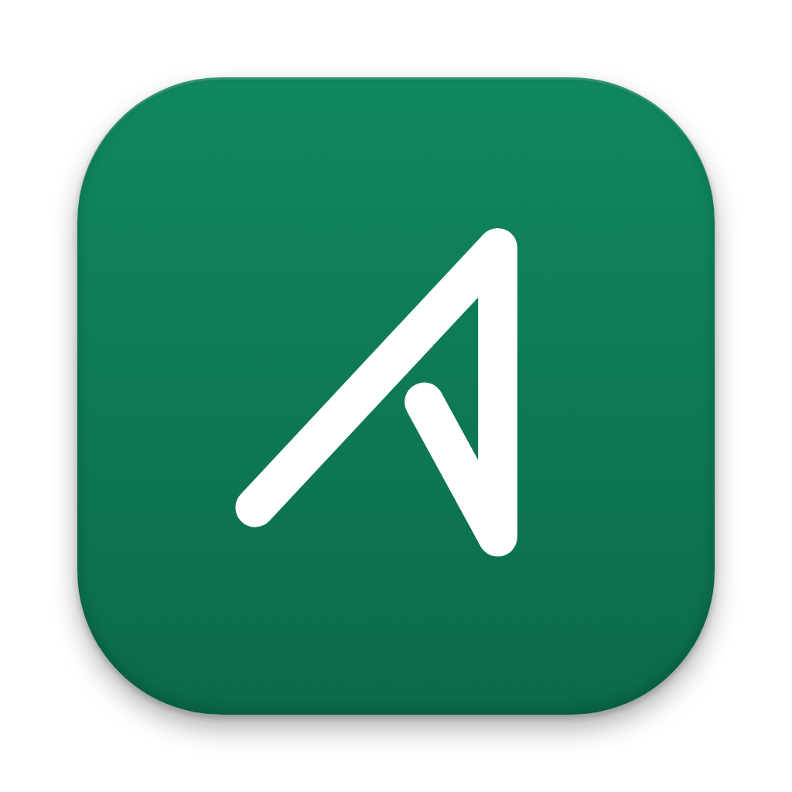

<p align="center">
  
</p>

<h1 align="center">Aside</h1>

<p align="center">A private helper that sits beside you during a call — only you can see it.</p>

---

## What Aside actually does

In a theatre, an "aside" is when an actor turns to the audience and says something privately, while the scene keeps going and the other characters on stage don't hear it. That's what this app does for you during a video call, meeting, or interview.

While your call is happening normally, Aside is quietly:

- **Listening** — to both what you say and what the other person says, kept as two separate tracks so it always knows who said what.
- **Remembering** — anything you've given it ahead of time, like your résumé, a job description, or your own notes about the call.
- **Waiting for you to ask for help** — it never jumps in on its own. You press one shortcut key (Command+Enter), and it privately shows you a suggested thing to say, based on everything it just heard and everything you gave it.
- **Looking at your screen when you ask it to** — for example, if someone shares a coding problem on screen, you can ask Aside to look and explain it to you, privately.
- **Staying invisible to everyone but you** — Aside is built to not show up in screen shares, screen recordings, or screenshots taken during the call (Zoom, Google Meet, Microsoft Teams). Only you, looking at your own screen, can see it.

It runs on your own computer, not in the cloud (aside from sending your question to an AI service to get an answer, the same way you'd type a question into a chatbot yourself).

This is a personal project, built for the owner and a couple of friends — not a commercial product.

## How it's built, in plain terms

Aside is one single program made of two halves that work together:

1. **The engine** (written in a language called Rust) — this half does all the "talking to your computer" work: turning on the microphone, capturing the audio your computer is playing, saving things to a private file on your own machine, remembering permissions, and sending your question off to an AI service when you ask for help.
2. **The screen you look at** (written using React, a common toolkit for building app interfaces) — this half draws everything you actually see: the buttons, the settings page, the little overlay window during a call, and the answer that shows up when you ask for one.

Those two halves constantly pass messages back and forth inside the same app — there's no separate server, no separate database somewhere else, and nothing about your calls leaves your computer except the specific question you choose to ask, sent to whichever AI provider you've connected.

## Getting Aside running

### Option A — Just use the app (no coding needed)

1. Go to this repository's **[Releases](../../releases)** page and download the latest `Aside.dmg` file.
2. Open the downloaded file and drag **Aside** into your **Applications** folder.
3. Because this is a small personal project and not a paid, notarized app from the App Store, the first time you open it macOS will show a warning that it's from an unidentified developer. Right-click (or Control-click) the app and choose **Open**, then confirm — you only need to do this once.
4. The first time you use a call feature, macOS will ask you to approve **Microphone** access and **Screen & System Audio Recording** access. Both are needed: the first so Aside can hear you, the second so it can hear the other person's audio and (only if you ask it to) look at your screen.
5. Open **Settings** inside Aside and add your own API key for whichever AI provider you want answers from (for example OpenAI or Anthropic). Aside doesn't come with one built in — you bring your own, the same as you would for any AI chat app.

### Option B — Build it yourself from the code

You'll need three things installed first: [Node.js](https://nodejs.org/), [Rust](https://www.rust-lang.org/tools/install), and, on a Mac, Apple's Xcode Command Line Tools (`xcode-select --install`).

```bash
git clone https://github.com/devvs-reddy-n/Aside.git
cd Aside
npm install
```

- To try it while you're changing things (fast, a couple of seconds to reload):
  ```bash
  npm run tauri dev
  ```
- To build a real, installable copy of the app (slower — a few minutes, because it has to fully package the speech-recognition engine):
  ```bash
  ./scripts/build-app.sh
  ```
  This leaves a ready-to-use `Aside.app` in the project's root folder.

## What's finished and what's still in progress

This is an actively evolving personal project, not a polished 1.0 release. [`status.md`](status.md) keeps an honest, feature-by-feature checklist of what's actually been built and verified versus what's still a work in progress, and [`CURRENT.md`](CURRENT.md) has the current day-to-day snapshot of what's being worked on.

## A note on the `references/` folder

If you look at the code, you won't find a `references/` folder — it's intentionally left out (see `.gitignore`). Locally, the project owner keeps a copy of a similar existing meeting-assistant app there purely to compare notes and get inspiration on how certain features were approached; it's someone else's project under its own license, so it isn't copied or redistributed here.
